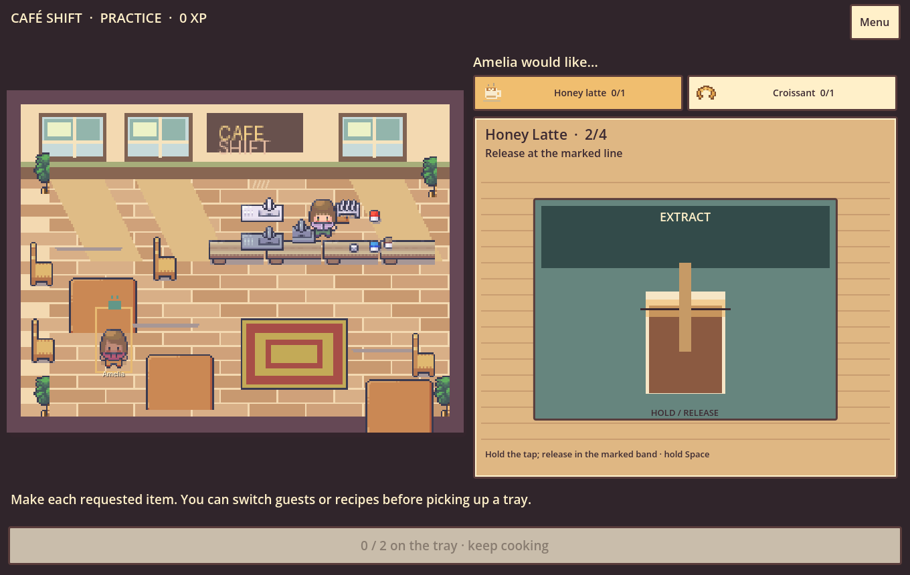

# CAFÉ SHIFT — Rush Hour

A playable Godot 4 café game for [PIXL project 1646](https://pixl.hackclub.com/projects/1646). Prepare individual drinks and food, build a complete tray, and hand it to the guest who ordered it.

**[Play in your browser](https://cafe-shift-rush-hour.vercel.app/)** · **[Download a Web build](https://github.com/Hustlenix/cafe-shift-rush-hour/releases/latest)**



## Play at the counter

1. Choose **New practice** for an untimed first shift, or **Rush hour** for five guests in three minutes. The opening menu pauses a saved shift.
2. Tap a guest in the café. Their requested items appear beside the preparation surface; select the item you want to make.
3. Handle its ingredients and equipment. Drag ingredients into place, hold and release a tap at the cup line, whisk with alternating strokes, watch heat and lift at **GOLDEN**, slice down a marked seam, or drag food onto a plate. Each of the nine products has its own authored sequence.
4. Finish every requested quantity. Pick up the complete tray, then tap that same guest in the café. The food moves to the guest before the order completes and XP is awarded.

Mistimed pours, burnt batches, bad cuts and misplaced food are recoverable. A wrong recipient cannot receive a tray; an incomplete order cannot be delivered. A hot batch or active pour needs your attention before switching recipes. Between those actions, choose which guest or item to work on next. Faster service earns tips; careful preparation adds bounded quality XP.

The gameplay view has one active request and one workbench, without a catalog search, customer form, duplicate queue, workflow columns, station tabs, or page scrolling. Portrait and short landscape have dedicated layouts that keep the request, equipment and tray in the viewport.

**Keyboard:** G cycles guests; Tab selects an item or the tray; Enter activates it. At the workbench, Space places an ingredient, starts/lifts heat, or controls a held pour. Alternate Left/Right to whisk; Enter offers a guided slice or plates food. Esc pauses. Settings include sound/ambience and reduced motion.

Tickets, finished tray counts, completed recipe steps, shift state, lifetime XP and best records save locally. Reloading restarts only the unfinished gesture. New shifts require confirmation when there is current work and preserve lifetime XP. Existing version 1/2 saves migrate to version 3. Future save versions are left untouched.

## Original trial ordering system

Choose **Order desk / connect a kitchen** from the menu for the working ordering application: nine products, categories, search, quantities, totals, guest/table fields, order placement, and kitchen tickets with **New → Preparing → Done** controls. This operations mode is preserved separately from the hands-on game. Its original generic pour meter remains there; it is not the gameplay preparation system.

To pair devices, open Order Desk on two clients. On the till, choose **Connect devices → Create till room → Copy kitchen code**. On the other client, choose **Connect devices**, paste the code under **Join as kitchen**, and join. Submit an order from the till; only the kitchen credential can advance it. Both clients poll the deployed HTTPS API every two seconds.

The Vercel backend uses Neon Postgres. Prices and transitions are authoritative on the server. Room credentials use random tokens stored as SHA-256 hashes; the connection string stays in server environment variables. Tokens remain in client memory, never URLs. Rooms expire in seven days and hold up to 100 tickets. Refreshing the till requires a fresh room. Disconnect before returning to the solo café.

The existing two-process and two-Web-client synchronization evidence is in [VERIFICATION.md](docs/VERIFICATION.md), [sync-proof.json](docs/sync-proof.json), and the screenshots there. Those proofs were performed on one computer; physical cross-device/mobile-network behavior remains a separate test boundary.

## Run and verify

Open `project.godot` in Godot **4.7.1** and press F5. Compatibility rendering and matching Web export templates are required.

```sh
godot --headless --editor --path . --quit
godot --headless --path . --script res://tests/test_core.gd
godot --headless --path . --script res://tests/test_orders.gd
godot --headless --path . --script res://tests/test_preparation.gd
godot --path . --script res://tests/test_counter_ui.gd
godot --path . --script res://tests/test_ui.gd
godot --headless --path . --export-release Web builds/web/index.html
python tools/verify_live_export.py
python tools/package_release.py
```

Preparation tests cover all product sequences, failed-action recovery, exact tray contents, duplicate rewards, mid-recipe persistence, and five crafted deliveries. The counter GUI suite injects real viewport pointer, keyboard and touch events; it serves all six authored request combinations, checks multiple viewport sizes, and tests the round trip to Order Desk. Skill timing is advanced deterministically in the suite. This is not a physical-phone or controller test.

Tests disable player-save and settings writes or use isolated temporary fixtures. Screenshots come from the running game. Check logs for parser/runtime errors as well as the exit code. Current results, scope and limitations are recorded in [VERIFICATION.md](docs/VERIFICATION.md) and [the ten-finding redesign record](docs/COUNTER_REDESIGN.md). No novice usability sessions or preference improvements are claimed.

## Architecture

| Component | Owner |
| --- | --- |
| `main.gd` | Mode routing and viewport scaling |
| `counter_screen.gd` | Scene-local guest, preparation and handoff coordination |
| `preparation.gd`, `recipes.gd` | Physical-item state machine and immutable recipe definitions |
| `prep_bench.gd` | Equipment drawing and pointer/touch/keyboard translation |
| `order_slip.gd`, `counter_menu.gd` | Active request, mode/pause/settings/report UI |
| `counter_audio.gd`, `counter_theme.gd` | Playback and shared visual resources |
| `order_store.gd`, `shift_rules.gd` | Authoritative orders, prepared counts, saves, requests, timing, XP and rewards |
| `order_desk.gd`, `kitchen_sync.gd` | Preserved trial UI and genuine HTTPS synchronization |
| `cafe_view.gd` | Licensed room, animated customers and handoff feedback |

## Art, AI assistance and tracking

The owner's paid **Modern Interiors** pack by [LimeZu](https://limezu.itch.io/moderninteriors) supplies the café props and six animated regulars. The room layout is composed specifically for this game. Raw paid artwork and the composed room remain ignored under `assets/licensed/`. The release contains compiled gameplay, not a redistributable asset pack.

The public source runs with an original fallback when the licensed art is absent. Owners of the pack can run `python tools/import_assets.py --pack /path/to/moderninteriors-win` with Pillow installed. Never add `assets/licensed/` to Git. The new product silhouettes are original grid-authored SVGs, reproducible with `tools/make_counter_icons.py`; sounds and equipment drawings are code-authored.

OpenAI Codex audited and repaired the starter and wrote/revised game, UI, backend, tests and original asset-generation code. LimeZu authored the purchased art. This README does not claim the human independently created AI-assisted work.

Hackatime configuration remains unchanged. Automated edits are not converted into synthetic human hours. No development duration or PIXL journal entry has been fabricated. Fictional prices are for the game; it processes no payments.
