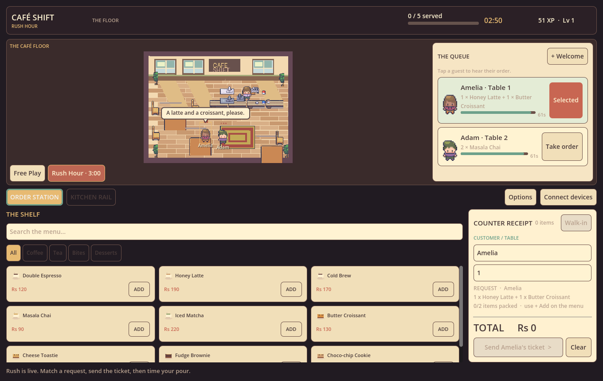

# CAFÉ SHIFT — Rush Hour

A playable **Godot 4** café game for [PIXL project 1646](https://pixl.hackclub.com/projects/1646). Ring up drinks and bites, print kitchen tickets, prepare orders, and keep the regulars happy.



## Play

**[Play the verified Web demo](https://cafe-shift-rush-hour.vercel.app/)** · **[Download the Web build](https://github.com/Hustlenix/cafe-shift-rush-hour/releases/latest)**

Open `project.godot` in Godot **4.7.1** and press **F5**. The core uses native Godot Controls and GDScript.

- **The till:** nine items, four categories, search, quantity controls, cart total, guest/table entry, and order placement. A live recipe checklist shows the selected customer's exact order, what's packed, and when the ticket matches.
- **The kitchen:** submitted tickets move **New → Preparing → Done**. While preparing, time the moving pour needle in the green window for up to 20 extra XP. Serving right away is allowed; waiting costs time during Rush Hour.
- **Free Play:** no timer. Serve customer requests or create custom orders.
- **Rush Hour:** a new save opens with two waiting customers and a live three-minute timer. Serve **five exact customer requests**. Each waiting guest has a visible patience countdown; a missed guest leaves with a sound and message, and the till automatically selects the next waiting guest. Early service earns bonus XP. Submitted tickets stay valid when patience runs out. The shift ends with a results card: per-shift tips, your best streak, a 0–3 star rating, and a **NEW BEST** banner with confetti when you beat your record.
- **Progress:** cart, tickets, lifetime XP, best-run records and the current shift save locally. Reset requires confirmation. A fresh shift preserves lifetime XP.
- **Options:** sound effects, café ambience music and reduced motion. Standard buttons support keyboard focus and activation; **Esc** clears the tray or your selection, and keys **1** / **2** switch between the order desk and the kitchen.

The first waiting guest is selected for you. The order panel shows their recipe and packing progress. Add the exact items, send the ticket, then open the kitchen and start preparing. In the green pour window, serve for a quality XP bonus; serve early to save Rush time. Mismatched requests stay in the cart so you can correct them. In Free Play, the **Walk-in** control switches to unrestricted custom orders.

## Verified status

The starter was imported and repaired on 2026-10-13; the gameplay revision was tested with Godot 4.7.1 on Windows on 2026-10-14:

- Original parser failure fixed: the starter's `_input()` form helper collided with Godot's built-in input callback.
- Original order smoke test passes without leaked objects.
- **79 core checks pass:** totals, quantities, exact recipes, capped pour rewards, first-run Rush setup, duplicate rewards, five-order victory, timer failure, persistence, invalid save lines, duplicate restored IDs, future-schema protection, shift tips, best-streak tracking, one-time best-run records, and legacy-save defaults.
- **53 native GUI pointer activations pass**, plus keyboard activation: kitchen-tab Enter, Esc tray clearing, 1/2 station switching, and the rush-clock urgency states. These exercise categories, all nine Add buttons, every quantity button, cart clearing, recipe matching and blocking, customer selection, preparation, pour timing, completion, the results card (stars, NEW BEST banner, tips line), shift controls, options (sound, music, motion) and reset confirmation.
- **30 backend security checks pass** against a real SQLite fixture: role enforcement, room isolation, menu/quantity validation, authoritative prices, idempotent order submission including a full room, and atomic status transitions.
- **Two independent Godot processes pass against the deployed HTTPS API and real Postgres database.** The till sends two lattes and one chai (Rs 470); the kitchen receives New, advances Preparing and Done, and the till sees Done automatically. Actual process IDs, timing and room-revocation acknowledgement are in [the client logs](docs/sync-proof.json).
- **Two Web clients also complete the actual UI flow:** create room, copy/paste code, join kitchen, submit Ada's Rs 470 ticket, prepare, complete and automatically receive Done at the till. [Till proof](docs/screenshots/web-sync-done-pos.jpg) · [kitchen proof](docs/screenshots/web-sync-done-kitchen.jpg).

Screenshots in `docs/screenshots/` are captured from the running Godot game by the UI test. They are not mockups.

The exported game and backend are hosted on Vercel; the database is Lakebase Postgres on Neon's free plan. No development hours or PIXL journal entries have been invented. See [verification evidence and remaining device-QA limits](docs/VERIFICATION.md).

## Connect a till and kitchen

1. Open the demo on two clients. On the till, choose **Connect devices → Create till room → Copy kitchen code**.
2. On the kitchen, choose **Connect devices**, use **Paste** beside **Join as kitchen**, and click **Join kitchen**. You can also enter the code with the keyboard.
3. Close the dialog. Send a till order and watch it appear in the kitchen. Only the kitchen credential can advance tickets. Both clients refresh automatically every two seconds.

Room tokens use 192 bits of randomness and are stored as SHA-256 hashes on the server. The database connection string stays in Vercel's server environment. Tokens are kept in client memory and never placed in URLs. Keep the kitchen code private. Rooms expire after seven days and hold up to 100 tickets. Rejoining after a refresh requires the kitchen code; refreshing the till requires a fresh room. **Disconnect** returns to the locally saved game.

Online tickets persist in the server database independently of offline NPC challenges and XP. Online service uses HTTPS polling; it is not a WebSocket connection. The two-process proof was performed on this computer, not on a physical phone.

## Run tests

```sh
godot --headless --editor --path . --quit
godot --headless --path . --script res://tests/test_orders.gd
godot --headless --path . --script res://tests/test_core.gd
godot --path . --script res://tests/test_ui.gd
npm ci
npm run test:backend
python tools/test_network.py --endpoint https://cafe-shift-rush-hour.vercel.app
```

The core tests use isolated temporary data. The GUI test disables saving and uses Godot viewport input; it also writes actual gameplay screenshots. Node 24 supports the backend's built-in SQLite test adapter. The network runner starts two separate Godot processes with no shared ticket model, privately passes a temporary pairing credential, and revokes the test room afterward. Supply `--godot /path/to/godot` on other systems. A passing process exit alone is insufficient for import checks: inspect output for `SCRIPT ERROR` and `ERROR` too.

## Art and licenses

The owner's paid **Modern Interiors** pack by [LimeZu](https://limezu.itch.io/moderninteriors) supplies the café props and six animated regulars. The café layout is composed specifically for this game. Raw paid sprites and the composed paid-art room are ignored by Git because the asset license prohibits redistributing the asset pack. Gameplay screenshots may show the artwork as part of the game.

The public source runs with an original simple room/character fallback when the licensed art is absent. To reproduce the owner's art build using your own licensed pack:

```sh
python -m pip install pillow
python tools/import_assets.py --pack "/path/to/moderninteriors-win"
```

The script composes `assets/licensed/cafe.png` and copies the required animation strips locally. **Do not add `assets/licensed/` to Git.** Food icons, sample chimes and the app icon in `assets/original/` are original code-authored assets, included with the source; `tools/make_app_icon.py` draws the window icon / web favicon from the in-game palette with no external art.

## Architecture

| File | Responsibility |
| --- | --- |
| `scripts/order_store.gd` | Menu, cart, tickets, XP, authoritative mutation methods, validated atomic local saves |
| `scripts/shift_rules.gd` | Requests, recipes, patience, arrivals, run goal, bonuses, results |
| `scripts/main.gd` | Stable native UI, menu/search/cart, kitchen, dialogs, sound |
| `scripts/cafe_view.gd` | Live café art, customer animation, speech bubbles, steam |
| `scripts/kitchen_sync.gd` | HTTPS client, role credentials, automatic polling, retry-safe submission |
| `scripts/main_starter.gd` | Preserved repaired starter interface for reference |
| `backend/worker/index.js` | Shared room API, authoritative prices and atomic transitions |
| `api/index.mjs`, `backend/neon_adapter.mjs` | Vercel handler and parameterized Postgres adapter |
| `backend/migrations/001_postgres.sql` | Production schema; SQLite schema in `backend/drizzle/` is for tests |
| `tests/` | Godot smoke, core and GUI checks |

The offline game runs without keys or services. Browser local saves depend on storage permission; private browsing may discard them. Prices are fictional rupee amounts; no payment processing occurs.

## AI assistance and tracking

OpenAI Codex audited and repaired the supplied starter, wrote and revised the game/UI/backend code, authored the original icon/chime generation scripts, ran the tests, and captured the screenshots. LimeZu authored the purchased art. This README does not claim the human independently wrote or tested AI-authored code.

The existing Hackatime configuration was inspected read-only and still points to Hack Club's endpoint. It was not rewritten. Automated work is not represented as human development hours; no synthetic heartbeats or journal entries were submitted.

## Build and release

Use the Godot Web export templates matching 4.7.1 and the Compatibility renderer. Disable threads for a static host. Publish all generated files together, then verify menu → cart → kitchen → done and persistence on the hosted build before treating a demo URL as shipped. See [Godot Web export documentation](https://docs.godotengine.org/en/stable/tutorials/export/exporting_for_web.html).

```sh
godot --headless --path . --export-release Web builds/web/index.html
vercel link
vercel env pull .env.local
npm run db:migrate
vercel deploy --prod
python tools/package_release.py --out builds/release
```

Provision your own Neon database and set `DATABASE_URL` (pooled) and `DATABASE_URL_UNPOOLED` (migration) in Vercel before deploying the API. Do not commit `.env.local`. For local API development, run `npm run dev:backend`; the supported endpoint is `http://127.0.0.1:8790`. Native clients require HTTPS outside that loopback exception.
