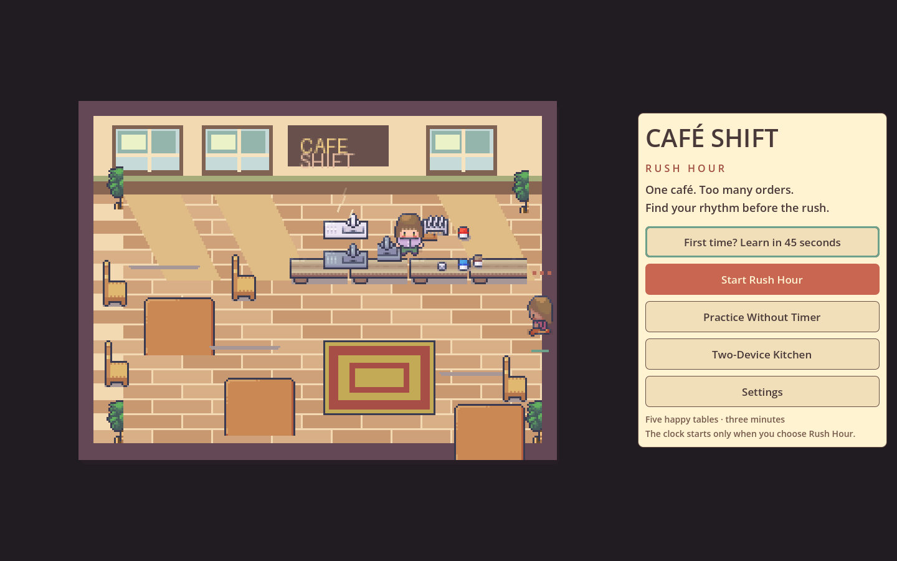
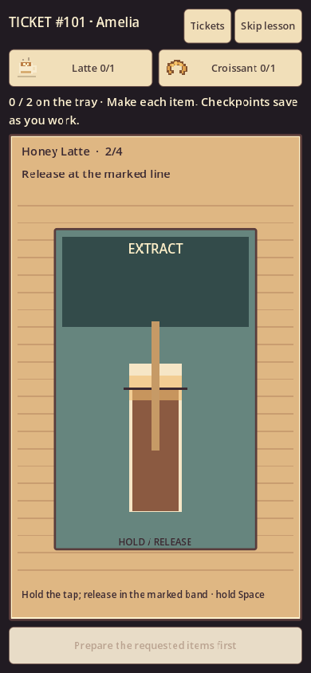
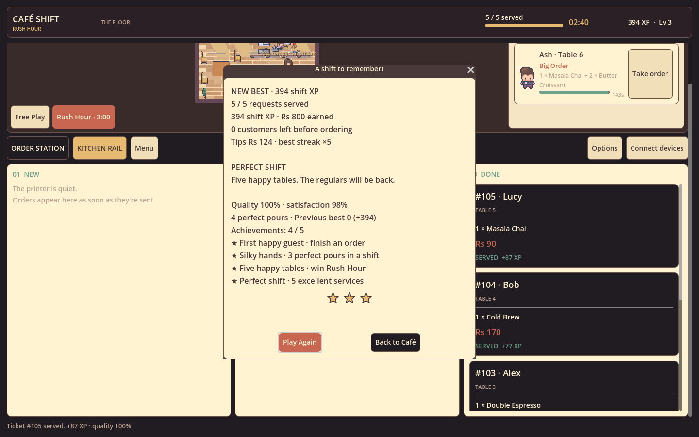

# CAFÉ SHIFT — Rush Hour

A Godot café game for [PIXL trial 1646](https://pixl.hackclub.com/projects/1646). Take a customer's request, match their order, print a kitchen ticket, and prepare each drink or dish. Serve five orders in a three-minute Rush Hour, or learn in untimed practice.

**[Play in your browser](https://cafe-shift-rush-hour.vercel.app/)** · **[Download a compiled build](https://github.com/Hustlenix/cafe-shift-rush-hour/releases/latest)** · **[Test evidence and limitations](docs/VERIFICATION.md)**

## Your first order

The welcome screen starts with the clock stopped. Choose the skippable tutorial, **Practice Without Timer**, **Start Rush Hour**, or **Two-Device Kitchen**.

1. Select a guest on the café floor, or use their **Take order** button.
2. Add the requested products. Quantity buttons and the receipt tell you what to add or remove.
3. Send the matching ticket, open Kitchen, and choose **Start preparing**.
4. Follow the equipment instructions: drag ingredients, hold/release pours, heat, stir, slice and plate. Missed steps can be retried.
5. Serve the finished tray. Tickets cannot be served twice. Five completed requests win Rush Hour.

Personalities affect patience and tips. Lunch Rush, a VIP visit and Perfect Service add pressure later in a shift. Options includes sound, ambience and reduced motion. Returning to the welcome screen or opening settings pauses offline gameplay.

### Controls

Mouse and touch use the visible controls. Drag ingredients onto equipment/plates, hold a dispenser and release in the marked band, or tap heating equipment to start/lift. Keyboard preparation uses Space, Enter and alternating Left/Right; each step displays its controls. Tab selects buttons and Enter activates. Use 1 for the order desk and 2 for Kitchen. Escape returns from preparation; at the desk it clears the cart or selected request.

## Running game screenshots

Native Godot captures from automated input tests, not browser screenshots or mockups:







## Run from source

Install **Godot 4.7.1 Standard** (GDScript, Compatibility renderer) and Git. These commands assume Godot is on PATH as `godot`; on Windows substitute your full `Godot_v4.7.1-stable_win64_console.exe` path if needed.

```sh
git clone https://github.com/Hustlenix/cafe-shift-rush-hour.git
cd cafe-shift-rush-hour
godot --headless --editor --path . --quit
godot --path .
```

Alternatively, import `project.godot` in Godot's project manager and press F5. Offline play requires no database, account, Node.js or environment variables. Saves/preferences use Godot's per-user application-data directory. Save versions 1–4 are supported; saved shifts resume only when selected.

The public clone includes original fallback café/character rendering and original food art. Paid Modern Interiors source art is absent. The compiled hosted game uses the owner's licensed pack. Both versions have the same gameplay.

## Optional two-device kitchen

On the first client choose **Two-Device Kitchen** and create a till room. On another client join using the complete kitchen code. The till sends orders; Kitchen prepares and serves them; the till receives status updates automatically. This uses HTTPS polling, not WebSockets. Credentials expire after seven days and stay in memory; reloading can require a new room. Keep the kitchen code private.

After an ambiguous send failure, use **Retry connection / pending ticket** before sending another order. The retry retains the same ticket key to prevent duplicates. Invalid/expired rooms require disconnecting and creating/joining a room. Online orders do not award offline shift XP.

### Local API development

Install **Node.js 24.x**, then run from the root:

```sh
npm ci
npm run dev:backend
```

Set the game's connection endpoint to `http://127.0.0.1:8790`. This loopback-only server creates SQLite data under ignored `work/`; no Neon account or secrets are needed. Other endpoints require HTTPS.

For your own production backend, `api/index.js` uses Neon Postgres on Vercel. Configure `DATABASE_URL` (pooled runtime) and `DATABASE_URL_UNPOOLED` (migration) in your own Vercel environment. Put migration values in private `.env.local`, run `npm run db:migrate`, export the game to `builds/web`, then deploy to your own project. Never commit environment files or room credentials. Ordinary players use the already configured public backend.

## Tests

Import the project first, then run:

```sh
godot --headless --path . --script res://tests/test_core.gd
godot --headless --path . --script res://tests/test_customers.gd
godot --headless --path . --script res://tests/test_preparation.gd
godot --headless --path . --script res://tests/test_events.gd
godot --headless --path . --script res://tests/test_progression.gd
npm run test:backend
godot --headless --path . --script res://tests/test_sync.gd
```

The sync suite starts/stops its own server; keep port 8790 free. Native UI suites require a graphical desktop and must run sequentially:

```sh
godot --path . --script res://tests/test_ui.gd
godot --path . --script res://tests/test_onboarding.gd
godot --path . --script res://tests/test_physical_ui.gd
godot --path . --script res://tests/test_cafe_floor.gd
```

To test two independent processes against your own running API:

```sh
python tools/test_network.py --godot "/path/to/godot" --endpoint http://127.0.0.1:8790
```

This creates and revokes a temporary room. Fixture tests, native input tests, hosted file comparisons and browser playthroughs provide different evidence; see the verification page for the actual scope.

## Export a playable Web build

Install Godot's matching **4.7.1 export templates**. Create `builds/web` first (`mkdir -p builds/web` on Linux/macOS; `New-Item -ItemType Directory -Force builds/web` in PowerShell), then:

```sh
godot --headless --path . --export-release Web builds/web/index.html
python -m http.server 8787 --directory builds/web
```

Open `http://localhost:8787`. Double-clicking `index.html` will not work: WebAssembly needs HTTP. Threads are disabled, so cross-origin isolation is unnecessary. Browser saves depend on site-storage permissions. To package the exported files:

```sh
python tools/package_release.py --out builds/release
```

Maintainer releases also run `python tools/stamp_export.py` from a clean committed checkout. The deployed `/release.json` identifies that source commit and hashes the six runtime files; it is evidence of byte identity, not a browser-play test.

## Structure

- `order_store.gd`: validated cart/orders, offline saves, XP and achievements.
- `game_flow.gd` / `welcome_screen.gd`: onboarding, tutorial sandbox and explicit play/pause.
- `shift_rules.gd`, `customer_generator.gd`, `rush_events.gd`: seeded customers and challenge rules.
- `preparation.gd` / `recipes.gd`: preparation rules; `prep_bench.gd` / `preparation_station.gd`: equipment input and presentation.
- `kitchen_sync.gd`: role-specific network requests and reliable retries.
- `main.gd` / `cafe_view.gd`: interface composition and animated café.
- `backend/` / `api/`: validated room/ticket service and SQLite/Neon adapters.

These GDScript files live in `scripts/`.

## Art and licenses

Code and original assets use the [MIT license](LICENSE). The compiled café uses **Modern Interiors by [LimeZu](https://limezu.itch.io/moderninteriors)**, purchased by the owner. That artwork has its own license; MIT does not cover it. Do not extract or redistribute raw paid art.

If you own Modern Interiors, optionally import your own copy:

```sh
python -m pip install pillow
python tools/import_assets.py --pack "/path/to/moderninteriors-win"
```

The importer writes raw licensed art to ignored `assets/licensed/`. Purchase is optional for running the public source.

## AI assistance

This project uses substantial AI assistance. Codex generated/refactored significant portions of the Godot gameplay, UI, tutorial, persistence, customer generation, physical preparation, events, backend synchronization and automated tests. It also debugged failures, ran tests, prepared exports and revised this documentation. Original geometric food art and synthesized audio were produced with code-assisted tooling. Third-party sprites are credited above. The owner supplied project direction, the starter project, assets and iterative feedback. This does not claim that all tracked time was manual coding or that the owner authored every implementation.

Hackatime attribution, personal learning and journal entries require actual session evidence. Commit timestamps and AI test execution alone do not establish eligible human development hours.
